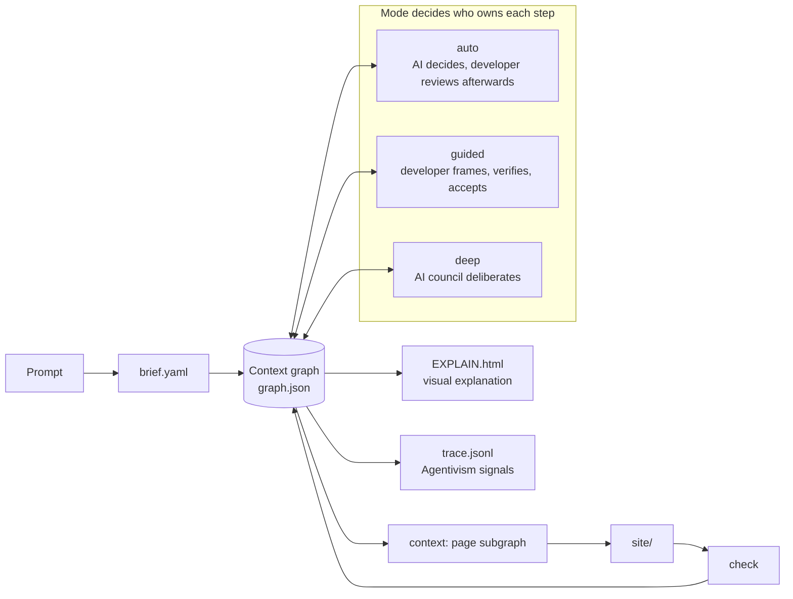
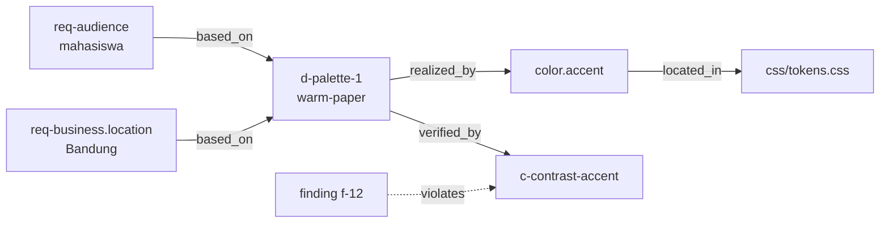

# Scaffolding, Agentivism, and Deep Work — architecture design

Date: 2026-10-17 · Status: open decisions accepted (§9); culture guide and phases 1–4 (context graph, EXPLAIN.html, trace and decide, guided mode) shipped

## Goal

ScaffolDev today turns one prompt into a checked website, but the developer only sees the
result. This design adds three things on one shared backbone:

1. **Guided mode** (scaffolding + Agentivism): the developer stays the author of the
   important judgments and comes out understanding the site, with support that fades as
   they grow.
2. **Visual explanation**: every project gets a page that shows what was decided, why, by
   whom, and where it lives in the code.
3. **Deep work mode** (musyawarah): a council of AI roles deliberates at each decision
   point, so one prompt yields a site that is ready to use without any back-and-forth.

All three read and write the same **context graph**, so the explanation, the scaffolding,
and the deliberation never disagree about what the project is.

**Success criteria**

- Every decision in a project can be traced, in one click on the explanation page, from
  requirement to decision to token or file to the check that verifies it.
- In guided mode the developer, not the AI, owns problem framing, criteria, and final
  acceptance (Agentivism P1), and every acceptance is preceded by a verification step.
- Support fades: a developer who passes the checkpoints on two consecutive projects gets
  less help on the next one, and can always override the level.
- Deep mode builds a site from one prompt with zero `check.py` errors, records the
  council's minutes, and invents no facts: what the prompt does not say is still a
  `[[ISI: …]]` placeholder.
- `SKILL.md` stays short. Mode instructions load only when that mode is active.
- For Indonesian projects, the agents work, design, and write the Indonesian way (§7), and
  everything a developer or client reads is in plain Indonesian.

## Theoretical basis

### Scaffolding (Wood, Bruner & Ross 1976; Vygotsky; van de Pol et al. 2010)

Scaffolding is temporary support that lets a learner do what they could not yet do alone,
and is withdrawn as they become able. Three properties make it scaffolding rather than
plain help, and each becomes a design rule:

| Property | Design rule in ScaffolDev |
| --- | --- |
| **Contingency**: support fits the learner's current level | Diagnose first: the support level comes from the developer profile and from how they phrase the prompt; guided mode starts with one framing question, not a lecture |
| **Fading**: support is withdrawn over time | Four support levels (below); the level drops after demonstrated success |
| **Transfer of responsibility**: the learner ends up doing it | At the lowest levels the developer writes parts themselves and ScaffolDev only verifies |

Wood et al.'s six scaffolding functions map onto concrete features: *recruitment* (the
capability card at the start), *reduction in degrees of freedom* (scripts handle every
deterministic step), *direction maintenance* (the step map), *marking critical features*
(decision cards highlight the one choice that matters most per step), *frustration
control* (exit code 3 asks instead of failing), *demonstration* (level 3 worked examples).

The plugin name says it: ScaffolDev scaffolds the developer, not only the site.

### Agentivism (Yan & Gašević 2026)

Agentivism defines learning with AI as durable growth in human capability, reached through
four linked mechanisms. Performance with AI support is not evidence of learning by itself.

| Mechanism | What ScaffolDev does |
| --- | --- |
| 1. **Delegated agency**: who is responsible for what | Every graph node records its owner (`developer`, `ai`, `script`, `council`). The step map shows the split before work starts. The developer keeps framing, criteria, and acceptance |
| 2. **Epistemic monitoring and verification** | Before accepting a decision the developer sees its evidence (requirements cited, alternatives rejected, how typical it is) and makes one verification move: pick, compare, or justify |
| 3. **Reconstructive internalization** | Explain-back and modify tasks: "why is the hero split-offset?", "change the accent token and predict which pages change" |
| 4. **Transfer under reduced support** | The fading levels: the next project asks the developer to do more of it |

The six propositions become measurable signals in the trace (`trace.jsonl`):

| Proposition | Signal recorded |
| --- | --- |
| P1 preserved responsibility | share of decisions with `owner: developer` or `accepted_by: developer` |
| P2 verification improves transfer | verification moves per acceptance |
| P3 reworking predicts retention | developer edits to AI output (files changed after `scaffold`) |
| P4 performance is not learning | check scores are reported next to, never instead of, the explain-back result |
| P5 process beats product | the trace itself; the explanation page shows it |
| P6 low-friction dependence risk | warning when the developer accepted every decision unverified on recent projects |

### Guidelines for Human-AI Interaction (Amershi et al. 2019)

The 18 guidelines are the interaction checklist. The ones this design implements:

| Guideline | Where |
| --- | --- |
| G1 make clear what the system can do · G2 how well | Capability card at start: site types, languages, what is checked automatically, what stays a placeholder |
| G4 show contextually relevant information | Context graph queries give each step only its subgraph |
| G9 support efficient correction | `run decide <slug> <decision> --choice …` overrides one decision and reruns only what depends on it |
| G10 scope services when in doubt | Exit code 3 questions; council escalates instead of guessing facts |
| G11 make clear why | Every node carries `why`; the explanation page shows it |
| G12 remember recent interactions · G13 learn from behaviour | Developer profile with support level and history |
| G14 update and adapt cautiously | The level changes by at most one step per project, and only between projects |
| G15 encourage granular feedback | Accept, reject, or modify per decision card |
| G16 convey the consequences of user actions | Impact query: changing a decision lists every token, file, and check it touches |
| G17 provide global controls | Mode and support level are set in one place and can always be overridden |
| G18 notify users about changes | `handoff` lists what changed since the last round |

## 1. Architecture overview



The pipeline steps of `web-build` stay the same. What changes is who owns each step, and
that every step reads from and writes to the graph instead of separate files only.

| Step | auto | guided | deep |
| --- | --- | --- | --- |
| 1 Brief | AI | developer confirms framing | AI, council's client advocate checks fidelity |
| 3 Direction | script samples | developer picks and justifies | council deliberates |
| 5 Copy | AI | AI drafts, developer edits (level ≤ 1: developer writes the hero) | council |
| 6 Build | AI | AI, with explain-back after the first page | AI, council reviews |
| 7 Check | script + AI fixes | same, developer reviews findings | same |
| 8 Handoff | summary + EXPLAIN.html | + reconstruction tasks, profile update | + council minutes |

## 2. Context graph

### Model

One file, `<project>/graph.json`, built and updated by scripts. Nodes:

| Type | Id example | Comes from |
| --- | --- | --- |
| `requirement` | `req-audience` | `brief.yaml` |
| `placeholder` | `ph:address` | `gaps.json` |
| `decision` | `d-palette-1` | `decisions.yaml`, `decide`, council |
| `token` | `token:color.accent` | `tokens.json` |
| `section` | `section:index#hero` | site type + scaffold |
| `file` | `file:css/components.css` | scaffold |
| `check` | `check:c-contrast-body` | `decisions.yaml` constraints |
| `finding` | `finding:12` | `report.json` |
| `deliberation` | `minutes:direction` (phase 5) | council minutes |

Also `page` (`page:index`) and `style` (`style:neobrutalism`, carrying the style's
components and signature moves for `context`).

Edges: `based_on` (decision → requirement), `realized_by` (decision → token, section,
style), `about` (check → token it inspects), `contains` (page → section),
`located_in` (token, section → file), `verified_by` (decision → check), `violates`
(finding → check), `decided_in` (decision → deliberation), `fills` (placeholder → section).

Every node carries `owner` (`developer`, `ai`, `script`, `council`), `why` (one line),
and for decisions `accepted_by` and `verification` (the move the developer made, if any).
This is the same model as the v0.4 RDF export in `IMPLEMENTATION.md` §3.12, so that export
becomes a serialisation of `graph.json` instead of a separate extraction.



### Scripts

- `run graph <slug>`: builds or refreshes `graph.json` from the project files. Every other
  script calls the same library function at its end, so the graph is never stale.
- `run graph <slug> --impact <node>`: lists everything downstream (G16). Used by `decide`
  and shown on decision cards.
- `run graph <slug> --why <node>`: the upstream chain, as one readable paragraph (G11).
- `context.py` becomes a query: the page subgraph, linearized as today, same output format,
  same 1,500-token budget. Its tests keep passing unchanged.

## 3. Visual explanation: `EXPLAIN.html`

`run explain <slug>` writes `<project>/EXPLAIN.html`, one self-contained file (no network,
no build step), and `handoff` calls it. In guided mode it is also opened at each
checkpoint. Four views:

1. **Step map**: the eight steps as a timeline, each coloured by owner, with what it
   produced. This is the Agentivism Fig. 1 model made concrete: where the developer
   delegated and where they verified.
2. **Decision cards**: one per decision: choice, why, requirements cited, the alternatives
   the other directions proposed, how typical it was (`probability`), who accepted it and
   how it was verified, and the impact list.
3. **Graph view**: requirement → decision → token/section → file → check, filterable by
   page. Clicking a node highlights its upstream and downstream chain.
4. **Your turn** (guided mode): the reconstruction tasks for this project and whether they
   were done.

Shipped in phase 2 for every mode: two questions with hidden answers (why one decision
was made, what changing the main colour affects), so even `auto` runs end with a route to
reconstruction. Guided mode (phase 4) adds tracking of whether they were answered.

Rendering: inline SVG drawn by a small vendored script, laid out in columns by node type
(requirements left, checks right), so it stays readable without a force layout. Light and
dark themes from the project's own tokens, so the page also previews the palette.

## 4. Guided mode (scaffolding + Agentivism)

### Support levels

| Level | Name | AI does | Developer does |
| --- | --- | --- | --- |
| 3 | Demonstrasi (worked example) | everything, narrating each step and why | reads, answers one check question per checkpoint |
| 2 | Terbimbing (guided) | proposes options with evidence | picks and writes a one-line justification |
| 1 | Petunjuk (hints) | critiques and hints | drafts the key parts: direction choice, hero copy, one component |
| 0 | Mandiri (independent) | verifies only (scripts + review) | does the step |

### Checkpoints

Three checkpoints, each a verification move before acceptance (Agentivism mechanism 2):

1. **Framing** (after step 1): the developer confirms or corrects the brief's audience,
   goal, and what counts as success. The AI never sets the criteria alone (P1).
2. **Direction** (after step 3): the five direction cards; the developer picks one and
   says why in a line that cites a requirement. At level 3 the AI picks and the developer
   predicts which one before seeing it.
3. **Acceptance** (after step 7): the developer reviews the explanation page and does the
   reconstruction tasks: one explain-back ("why does the price list use the mono font?")
   and one modify task ("make the accent warmer; which checks could fail?").

The AI judges explain-back answers against the graph's `why` chain, not against its own
opinion, so the judgment is reproducible. Answers go into `trace.jsonl`.

### Fading and the profile

The profile lives next to the dependency cache (`<cache>/profile.yaml`, overridable with
`PD_PROFILE`), so it follows the developer across projects:

```yaml
support_level: 2
history:
  - project: kopi-senja
    level: 2
    checkpoints: { framing: passed, direction: passed, acceptance: passed }
```

Rules: two consecutive projects with all checkpoints passed lower the level by one; a
failed acceptance raises it by one; it never moves more than one step per project (G14).
The two projects must be at the same level, so the streak restarts after every change;
a skipped checkpoint counts as not passed but does not raise the level. New developers
start at level 2 (Terbimbing): the developer already picks and justifies, which keeps
responsibility with them from the first project (P1).
"pakai level 3" or "aku mau mandiri" in a prompt overrides it for that project (G17).

## 5. Deep work mode: musyawarah

Deep mode spends more compute so the developer spends none: one prompt in, a site ready to
preview out. Quality comes from structured deliberation between AI roles, modelled on
*musyawarah untuk mufakat*: everyone is heard, objections are argued with evidence, and the
council converges on one decision, with voting only as the last resort.

### The council (majelis)

| Role | Perspective | Typical objection |
| --- | --- | --- |
| **Pimpinan sidang** (chair, the main agent) | process, synthesis, minutes | "that is not in the brief" |
| **Perancang** (design director) | distinctiveness, consistency with the style | "this looks like every cafe template" |
| **Penulis** (copywriter) | voice, register, local detail | "students do not talk like that" |
| **Arsitek front-end** | structure, performance, maintainability | "this needs JavaScript the page can do without" |
| **Penguji mutu** (a11y and QA) | WCAG, semantics, edge cases | "this contrast fails on the muted text" |
| **Wakil klien** (client and end-user advocate) | brief fidelity, no invented facts | "we do not know the price, that must be a placeholder" |

Role cards live in `skills/web-build/references/council/<role>.md`, each under 40 lines:
perspective, what to check, what evidence counts, and what the role must never do.

### Protocol per decision point

Sittings happen at three points: **direction** (step 3), **copy** (step 5), and **build
review** (after the first page in step 6, then once for the whole site before step 7).

```mermaid
sequenceDiagram
    participant C as Pimpinan (chair)
    participant R as Roles (in parallel)
    C->>R: Round 1: same packet (subgraph), propose independently
    R-->>C: proposals with evidence (graph node ids)
    C->>R: Round 2: all proposals, critique the others
    R-->>C: objections, each citing evidence
    C->>C: Round 3: synthesise; mufakat if no blocking objection
    alt objection still blocks after one revision
        C->>R: vote with weights by topic
        R-->>C: votes
    end
    C->>C: write minutes, update graph (owner: council)
```

- **Independent first round.** Roles see the same packet but not each other's proposals,
  so the council does not anchor on the first idea. This protects the diversity that
  Agentivism warns AI averaging erodes.
- **Evidence or it does not count.** An objection must cite a graph node (a requirement,
  check, or finding). Taste alone cannot block.
- **Mufakat rule.** A decision passes when no role keeps a blocking objection after one
  revision. Otherwise there is a weighted vote: the role that owns the topic counts double
  (Perancang for direction, Penulis for copy, Penguji mutu for build review). Dissent is
  recorded, never dropped.
- **Facts are not negotiable.** The Wakil klien can veto any invented fact. That veto is
  final, so deep mode stays honest.
- **Budget.** At most 2 rounds plus a vote per sitting, 4 sittings, so at most about 30
  subagent calls per site. Packets come from the graph, so each call stays small.
- **Fallback.** Without a subagent tool the chair plays the roles one after another and
  the minutes say "simulated council". Independence is weaker, but the protocol is the same.

### Minutes (notulen)

`<project>/deliberation/<sitting>.yaml`, validated by `schemas/deliberation.schema.json`:
packet, each proposal, each objection with its evidence, the resolution (`mufakat` or
`vote`), dissent, and the graph nodes written. `run council <slug> <sitting>` prepares the
packets (one per role) and, with `--record`, validates the minutes and writes their
decisions into the graph and the usual files (`directions.yaml`, `content/…`).

### One shot, ready to use

"Ready to use" means: `check.py` passes with zero errors and zero warnings, every page
renders with JavaScript off, every mock endpoint is documented in `API_CONTRACT.md`, and
`HANDOFF.md` lists exactly the placeholders still to fill. Deep mode does not stop for
questions. When a fact is missing it uses a placeholder. When a decision is ambiguous the
council decides and the minutes say so.

Deep mode keeps the developer in the loop *after* the run instead of during it: the
explanation page shows every council decision, the minutes are one click away, and the
handoff offers an optional three-question debrief. So even maximal delegation leaves a
route to verification and reconstruction (Agentivism mechanisms 2 and 3).

## 6. Choosing a mode

| Mode | Prompt signals | Default when |
| --- | --- | --- |
| `auto` | none | nothing else is said (today's behaviour) |
| `guided` | "mode terpandu", "ajari aku", "jelaskan langkahnya", "guided" | the profile says the developer chose it last time |
| `deep` | "deep work", "mode musyawarah", "langsung jadi", "one shot" | never by default; it costs more |

`brief.yaml` gets `mode: auto | guided | deep`. The existing `interactive: true` (browser
questionnaire for missing facts) stays independent and works in every mode except `deep`.

## 7. Indonesian culture and plain language

The shared guide is `skills/web-build/references/indonesia.md` (already shipped, read in
steps 3 to 6 whenever the brief includes `id` or the business is in Indonesia). This design
builds on it in three places.

**How the agents work.** Musyawarah untuk mufakat is the council's protocol (§5), and
the same norms apply to the single agent in every mode:

- *Santun tapi jujur*: polite, and still plain about every problem. No *asal bapak
  senang*: a failed check or missing fact is never softened away.
- *Usul, bukan vonis*: choices are offered as proposals with a reason; the developer's call
  is final once they have the evidence (Agentivism P1).
- *Gotong royong*: council roles build on each other's proposals instead of competing;
  round 2 asks each role to improve one other proposal before objecting to it.
- *Tepa selira*: objections are phrased as suggestions, but must still cite evidence.

**What the designs reflect.** Phone-first and light pages for mid-range Android on mobile
data, WhatsApp as the main call to action, landmark-based directions, trust signals that
only appear when stated (NIB, P-IRT, BPOM, halal, QRIS), Indonesian formats (Rp25.000,
08.00–21.00 WIB), and local identity taken from the brief rather than generic ornament.
The council's Wakil klien checks these, and a future `check.py` rule can verify the
measurable ones (a `wa.me` link in the hero, `lang="id"`, page weight).

**Plain language everywhere a person reads.** Checkpoint questions, decision cards,
`EXPLAIN.html`, `HANDOFF.md`, and council minutes use short sentences and everyday words.
A technical term is explained the first time it appears ("token warna (nilai warna yang
dipakai ulang di seluruh situs)"). The support levels have Indonesian names the developer
sees (Demonstrasi, Terbimbing, Petunjuk, Mandiri), and the explanation page's labels are
Indonesian when the brief is.

## 8. Keeping the skill light

- `SKILL.md` gains one short "Modes" section that names the three modes and says which
  reference file to read. The detail lives in `references/mode-guided.md`,
  `references/mode-deep.md`, and `references/council/*.md`, loaded only when that mode is
  active (progressive disclosure).
- New scripts follow the existing contract: one `run` command, a `NEXT:` line, the same
  exit codes, deterministic output.
- `auto` mode costs one extra script call (`explain`) compared with today.

## 9. Implementation phases

Each phase ends with green tests and is usable on its own.

| Phase | Build | Gate |
| --- | --- | --- |
| 1 | `lib/graph.py`, `run graph` (`--impact`, `--why`); `context.py` reads the graph; every script refreshes it | Existing tests unchanged and green; graph tests on `examples/kopi-senja` |
| 2 | `run explain`, `EXPLAIN.html` with step map, decision cards, graph view | Snapshot test of the generated page; it opens without network |
| 3 | `trace.jsonl`, `owner` and `accepted_by` on nodes, `run decide` with impact-based rerun | Overriding a decision changes only its downstream nodes |
| 4 | Guided mode: `references/mode-guided.md`, checkpoints, profile and fading | Unit tests for the fading rules; one guided build end to end |
| 5 | Deep mode: role cards, `run council`, `deliberation.schema.json`, `references/mode-deep.md` | One-prompt build with zero errors and valid minutes; simulated-council fallback tested |
| 6 | Measurement: Agentivism signals in `handoff`, and the eval harness compares auto, guided, and deep | Signals appear in `HANDOFF.md`; eval writes one CSV |

## 10. Decisions taken

Accepted in conversation on 2026-10-17:

| Topic | Decision |
| --- | --- |
| Default mode | `auto`, so existing users see no change; `guided` and `deep` on request |
| Council | six roles as in §5 |
| Profile | per machine, next to the dependency cache, so support fades across projects |
| Explanation page language | the brief's first language, like `HANDOFF.md` |
| Culture | agents, designs, and texts follow `references/indonesia.md` for Indonesian projects |

## References

- Amershi, S., Weld, D., Vorvoreanu, M., et al. (2019). Guidelines for Human-AI
  Interaction. *CHI 2019*. https://doi.org/10.1145/3290605.3300233
- Yan, L., & Gašević, D. (2026). Agentivism: a learning theory for the age of artificial
  intelligence. arXiv:2604.07813v2.
- Wood, D., Bruner, J. S., & Ross, G. (1976). The role of tutoring in problem solving.
  *Journal of Child Psychology and Psychiatry*, 17(2), 89–100.
- van de Pol, J., Volman, M., & Beishuizen, J. (2010). Scaffolding in teacher–student
  interaction: A decade of research. *Educational Psychology Review*, 22(3), 271–296.
- Vygotsky, L. S. (1978). *Mind in Society*. Harvard University Press.
